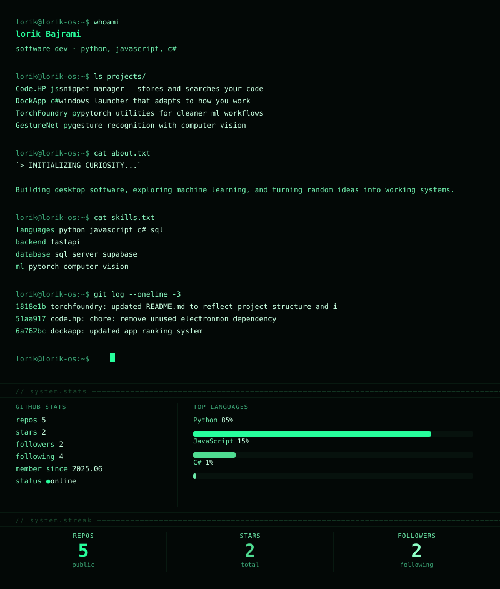

  

<b>LORIK OS</b> — text transcript &amp; links

**lorik Bajrami** — `lorik440`
> "ssssss... git push 💥"

| project | lang | ★ | description |
| --- | --- | --- | --- |
| [Code.HP](https://github.com/lorik440/Code.HP) | JS | 1 | background snippet manager — store, search & copy code |
| [DockApp](https://github.com/lorik440/DockApp) | C# | 0 | adaptive Windows launcher with a liquid-glass UI |
| [TorchFoundry](https://github.com/lorik440/TorchFoundry) | PY | 0 | PyTorch utility lib — reusable ML/training functions |
| [GestureNet](https://github.com/lorik440/GestureNet) | PY | 0 | gesture recognition model — model AI |

I build desktop tools and ML utilities — mostly C#, JavaScript & Python.  
GitHub: [github.com/lorik440](https://github.com/lorik440) · 5 repos · 2 followers

